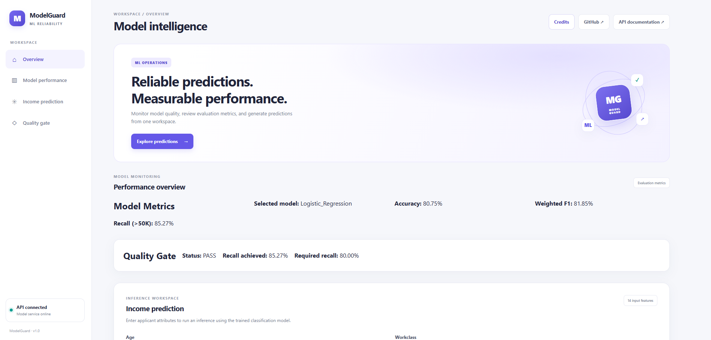
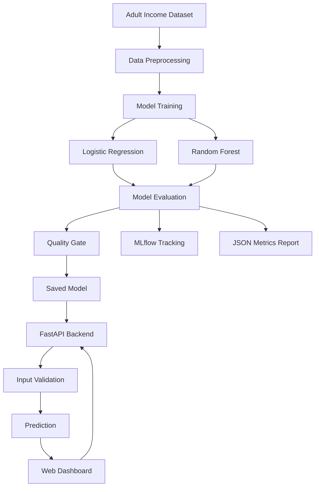

# ModelGuard — ML Reliability & MLOps Platform

**Build models. Verify quality. Deploy with confidence.**

ModelGuard is a machine learning reliability platform that evaluates models against predefined quality requirements. It combines model evaluation, experiment tracking, metric-based quality gates, a REST API, a custom web dashboard, automated testing, and Docker-based deployment.

- **Live Demo:** https://modelguard-1.onrender.com/
- **GitHub Repository:** https://github.com/kumawatmanish05/ModelGuard
- **API Documentation:** https://modelguard-1.onrender.com/docs

---

## 🖥️ Application Preview



*ModelGuard dashboard showing model performance metrics and quality-gate status.*

--- 

## 📌 Project Overview

A machine learning model with high accuracy can still fail to identify important cases. ModelGuard demonstrates how predefined quality requirements can be used to evaluate candidate models instead of selecting a model based on accuracy alone.

Using the UCI Adult Income dataset, the platform compares Logistic Regression and Random Forest classifiers and applies a recall-based quality gate for the `>50K` income class.

## ✨ Key Features

- **Machine Learning Pipeline:** Data preprocessing, model training, and evaluation using scikit-learn.
- **Model Evaluation:** Accuracy, weighted F1-score, and class-specific recall.
- **Quality Gates:** Evaluate models against predefined metric thresholds.
- **Experiment Tracking:** Track model experiments using MLflow.
- **Evaluation Reports:** Save model metrics in JSON format.
- **Prediction API:** Serve predictions using FastAPI.
- **Custom Web Dashboard:** Built using HTML, CSS, and JavaScript.
- **Automated Testing:** Validate model loading and prediction behavior.
- **Docker Support:** Containerize the application.
- **Cloud Deployment:** Deployed on Render.

---

## 🏗️ System Architecture



---

## 📊 Dataset

The project uses the **UCI Adult Income dataset** to predict whether an individual's annual income falls into the `<=50K` or `>50K` category.

| Property | Value |
|---|---|
| Total records | 32,561 |
| Input features | 14 |
| Training records | 26,048 |
| Testing records | 6,513 |
| Train/test split | 80% / 20% |
| Target variable | Income |

The dataset contains categorical and numerical features. The preprocessing pipeline encodes categorical variables and handles numerical features before model training.

---

## 🧠 Machine Learning Workflow

1. Load the dataset.
2. Inspect and preprocess the data.
3. Split the data into training and testing sets.
4. Encode categorical features and scale numerical features as required.
5. Train Logistic Regression and Random Forest classifiers.
6. Evaluate the trained models.
7. Apply the quality gate.
8. Record experiments using MLflow.
9. Save model artifacts and evaluation reports.
10. Serve predictions through the FastAPI application.

---

## 📈 Model Evaluation Results

| Metric | Logistic Regression | Random Forest |
|---|---:|---:|
| Accuracy | 80.75% | 85.60% |
| Weighted F1-score | 81.85% | 85.13% |
| Recall for `>50K` | 85.27% | 61.73% |
| Quality Gate | PASS | FAIL |

### Key Finding

Random Forest achieved higher overall accuracy, but its recall for the `>50K` class was lower than the required threshold.

Logistic Regression achieved 85.27% recall and passed the quality gate, while Random Forest achieved 61.73% recall and failed.

This demonstrates why model selection should consider the actual objective and not accuracy alone.

*Results reflect the recorded experiments and evaluation configuration.*

---

## 🚦 Quality Gate

ModelGuard uses a minimum recall threshold of `0.80` for the `>50K` class.

```python
RECALL_THRESHOLD = 0.80

if recall_over_50k >= RECALL_THRESHOLD:
    quality_gate_passed = True
else:
    quality_gate_passed = False
```

The quality gate checks whether a model meets the specified evaluation requirement.

A passing result indicates that the recorded evaluation metric meets the configured threshold. It does not guarantee every prediction will be correct or establish that the model is suitable for consequential decisions.

---

## 🌐 API Endpoints

The FastAPI application exposes the following endpoints:

| Method | Endpoint | Purpose |
|---|---|---|
| GET | `/` | Web dashboard |
| GET | `/health` | Health check |
| GET | `/model-info` | Model information and metrics |
| GET | `/quality-check` | Quality-gate status |
| POST | `/predict` | Generate a prediction |
| GET | `/docs` | Interactive API documentation |

### Example Prediction Request

```json
{
  "age": 39,
  "workclass": "Private",
  "fnlwgt": 77516,
  "education": "Bachelors",
  "education_num": 13,
  "marital_status": "Never-married",
  "occupation": "Adm-clerical",
  "relationship": "Not-in-family",
  "race": "White",
  "sex": "Male",
  "capital_gain": 0,
  "capital_loss": 0,
  "hours_per_week": 40,
  "native_country": "United-States"
}
```

Test the request using the interactive documentation:

https://modelguard-1.onrender.com/docs

---

## 🛠️ Tech Stack

| Category | Technologies |
|---|---|
| Programming Language | Python |
| Data Processing | pandas, NumPy |
| Machine Learning | scikit-learn |
| Experiment Tracking | MLflow |
| Model Serialization | joblib |
| Backend API | FastAPI |
| Frontend | HTML, CSS, JavaScript |
| Testing | pytest |
| Reports | JSON |
| Version Control | Git, GitHub |
| Containerization | Docker |
| Deployment | Render |

---

## 📂 Project Structure

```text
ModelGuard/
├── app/
│   └── main.py
├── frontend/
│   ├── index.html
│   ├── style.css
│   ├── script.js
│   └── credits.html
├── src/
│   ├── train.py
│   ├── evaluate.py
│   └── predict.py
├── data/
├── models/
├── reports/
│   └── metrics.json
├── tests/
├── Dockerfile
├── requirements.txt
├── .gitignore
└── README.md
```

*The tree above shows the main project components; individual files may vary with the current repository version.*

---

## 💻 Run Locally

### 1. Clone the repository

```bash
git clone https://github.com/kumawatmanish05/ModelGuard.git
cd ModelGuard
```

### 2. Create a virtual environment

```bash
python -m venv .venv
```

Activate it in Windows PowerShell:

```powershell
.\.venv\Scripts\Activate.ps1
```

### 3. Install dependencies

```bash
python -m pip install -r requirements.txt
```

### 4. Start the API

```bash
python -m uvicorn app.main:app --reload
```

Open the application:

- Dashboard: http://127.0.0.1:8000/
- API documentation: http://127.0.0.1:8000/docs
- Health check: http://127.0.0.1:8000/health

---

## 🐳 Run with Docker

Build the image:

```bash
docker build -t modelguard-api .
```

Run the container locally:

```bash
docker run --rm -p 10000:10000 -e PORT=10000 modelguard-api
```

Open:

http://localhost:10000/

Make sure Docker Desktop is running before executing these commands.

---

## 🧪 Run Tests

Run the automated test suite:

```bash
python -m pytest -v
```

The tests help verify core application behavior, including model loading and prediction functionality.

---

## 📉 Limitations

- The Adult Income dataset is intended for demonstration and educational purposes.
- The quality-gate threshold is configurable and is not a universal standard.
- Evaluation metrics depend on the dataset, preprocessing, and test split.
- Passing a quality gate does not guarantee individual predictions are correct.
- Continuous production data-drift monitoring is not currently implemented.
- Income predictions may reflect historical bias in the source data and should not be used as the sole basis for consequential decisions.

---

## 🚀 Future Improvements

- Add data-drift and prediction-drift monitoring.
- Implement more robust model promotion and rollback workflows.
- Add CI/CD automation for testing and deployment.
- Expand monitoring and model performance reports.
- Add additional evaluation metrics and configurable quality gates.
- Improve model versioning and production observability.

---

## 🎯 Learning Outcomes

This project demonstrates practical experience with:

- Building end-to-end machine learning workflows.
- Evaluating imbalanced classification problems.
- Comparing models using task-specific metrics.
- Implementing metric-based quality gates.
- Tracking experiments with MLflow.
- Creating REST APIs using FastAPI.
- Developing a custom frontend for an ML application.
- Writing automated tests.
- Containerizing and deploying an application with Docker and Render.
- Managing a project using Git and GitHub.

---

## 👨‍💻 Author

**Manish Kumawat**

GitHub: https://github.com/kumawatmanish05

---

## 📄 License

No license has been specified for this repository yet.
