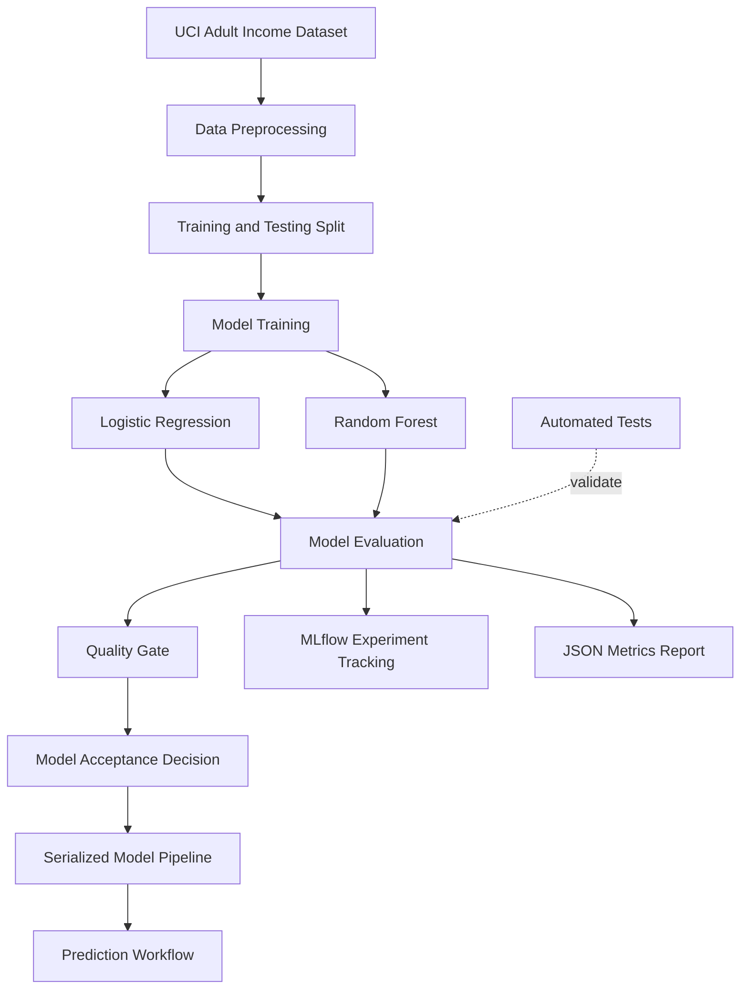
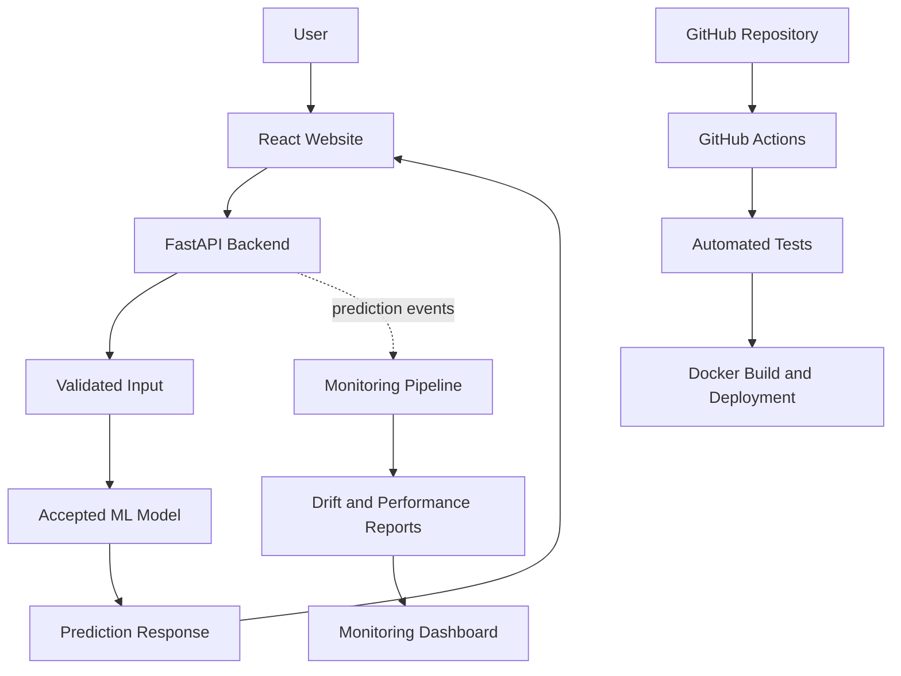

# ModelGuard — Production ML Reliability Platform

ModelGuard is an ML reliability and MLOps project designed to evaluate machine learning models against predefined quality requirements before they are considered for deployment. It combines model training, performance evaluation, experiment tracking, automated quality gates, and prediction workflows into a structured ML pipeline.

The project currently uses the UCI Adult Income dataset to demonstrate how a model with higher accuracy can still fail an important performance requirement.

> **Core idea:** A model should not be accepted based on accuracy alone. It should satisfy the metrics and quality requirements defined for its intended use case.

---

## Table of Contents

- [Project Overview](#project-overview)
- [Problem Statement](#problem-statement)
- [Project Objectives](#project-objectives)
- [Key Features](#key-features)
- [System Architecture](#system-architecture)
- [Machine Learning Workflow](#machine-learning-workflow)
- [Dataset](#dataset)
- [Model Evaluation and Results](#model-evaluation-and-results)
- [Quality Gate Mechanism](#quality-gate-mechanism)
- [Technology Stack](#technology-stack)
- [Project Structure](#project-structure)
- [Installation and Setup](#installation-and-setup)
- [Running the Project](#running-the-project)
- [MLflow Experiment Tracking](#mlflow-experiment-tracking)
- [Making a Prediction](#making-a-prediction)
- [Testing](#testing)
- [Limitations](#limitations)
- [Roadmap](#roadmap)
- [Future Architecture](#future-architecture)
- [Learning Outcomes](#learning-outcomes)
- [Contributing](#contributing)
- [License](#license)

---

## Project Overview

Machine learning models are often evaluated using metrics such as accuracy, precision, recall, and F1-score. However, a model with strong overall accuracy may still perform poorly on a class that matters most to the application.

ModelGuard addresses this challenge by introducing a quality-control layer into the machine learning workflow.

The current implementation:

- Preprocesses structured data using a reusable scikit-learn pipeline.
- Trains and evaluates Logistic Regression and Random Forest classifiers.
- Measures accuracy, weighted F1-score, and recall for the `>50K` income class.
- Applies a recall-based quality gate.
- Tracks experiments and evaluation metrics using MLflow.
- Saves evaluation results as a JSON report.
- Serializes the trained model pipeline for prediction.
- Includes automated tests for project components.

The long-term goal is to extend ModelGuard into a deployable ML reliability platform with a FastAPI backend, a custom React website, model and data monitoring, containerization, and automated CI/CD.

## Problem Statement

Consider an income classification model that achieves 85% accuracy.

At first glance, this appears to be a good result. However, if the model fails to identify a large proportion of people whose income exceeds $50K, its accuracy alone may hide a significant weakness.

This creates several practical challenges:

1. **Metric mismatch:** The highest-accuracy model may not be the best model for the intended objective.
2. **Uncontrolled acceptance:** Models can be selected without enforcing minimum performance requirements.
3. **Limited experiment visibility:** Comparing different models and configurations becomes difficult without experiment tracking.
4. **Reproducibility:** Training, preprocessing, evaluation, and prediction must use consistent transformations.
5. **Deployment reliability:** A model should be evaluated and tested before becoming eligible for deployment.

ModelGuard demonstrates a systematic approach to these challenges by evaluating candidate models against explicit acceptance criteria.

## Project Objectives

- Build a modular and reproducible machine learning pipeline.
- Compare multiple classification algorithms using consistent evaluation procedures.
- Establish a quality gate based on a relevant evaluation metric.
- Record experiment parameters and metrics in MLflow.
- Generate machine-readable evaluation reports.
- Separate model training, evaluation, and inference responsibilities.
- Strengthen automated testing and safe model acceptance.
- Extend the pipeline into a production-oriented ML application.

---

## Key Features

| Feature | Description | Status |
|---|---|---|
| Data preprocessing | Missing-value handling, encoding, and scaling | Implemented |
| ML pipeline | Reusable preprocessing and classification pipeline | Implemented |
| Model comparison | Logistic Regression and Random Forest | Implemented |
| Evaluation metrics | Accuracy, weighted F1-score, and recall | Implemented |
| Quality gates | Recall threshold of 0.80 for the demonstration | Initial implementation |
| MLflow tracking | Experiment runs, parameters, and metrics | Implemented |
| JSON reports | Save evaluation metrics to `reports/metrics.json` | Implemented |
| Model serialization | Save a trained pipeline using joblib | Implemented |
| Prediction workflow | Load the saved pipeline and generate predictions | Implemented |
| Automated tests | Test project components and model behavior | Initial implementation |
| Safe model acceptance | Prevent rejected models from replacing accepted artifacts | In progress |
| Drift monitoring | Detect changes in incoming data | Planned |
| FastAPI backend | Serve predictions through a REST API | Planned |
| React frontend | Custom website and monitoring dashboard | Planned |
| Docker and CI/CD | Containerization and automated checks | Planned |
| Online deployment | Publish the application online | Planned |

---

## System Architecture

### Current Implementation



The current pipeline focuses on training, evaluation, experiment tracking, and prediction. The acceptance workflow is being strengthened to ensure that only models meeting the required criteria become eligible for deployment.

### Planned Production Architecture



This is the intended architecture, not a claim that every component is already implemented.

---

## Machine Learning Workflow

### 1. Data Ingestion and Preprocessing

Preprocessing includes:

- Replacing missing-value markers with proper missing values.
- Imputing missing numerical values using the median.
- Imputing missing categorical values using the most frequent category.
- Scaling numerical features using `StandardScaler`.
- Encoding categorical features using `OneHotEncoder`.
- Combining transformations through `ColumnTransformer` and scikit-learn pipelines.

Keeping preprocessing inside the pipeline helps ensure that the same transformations are applied during training and inference.

### 2. Train-Test Split

The dataset is divided into training and testing subsets using an 80/20 split with stratification and a fixed random seed.

- Training records: 26,048
- Testing records: 6,513
- Input features: 14
- Target variable: `income`

Stratification helps preserve the target-class distribution across both subsets.

### 3. Model Training

**Logistic Regression**

A linear classification algorithm used as a baseline. The current configuration uses `max_iter=1000` and balanced class weights.

**Random Forest**

An ensemble of decision trees. The current configuration uses 100 trees, balanced class weights, and a fixed random seed.

Both models use the same general preprocessing strategy and are evaluated on the same test split.

### 4. Model Evaluation

The evaluation workflow calculates:

- **Accuracy:** Overall proportion of correct predictions.
- **Weighted F1-score:** F1-score averaged across classes, weighted by their support.
- **Recall for `>50K`:** Proportion of actual `>50K` cases correctly identified.

### 5. Quality Gate

The evaluation process compares recall for the `>50K` class against the configured minimum threshold.

For the current demonstration:

`Recall for >50K >= 0.80`

The result is recorded as a pass or fail, helping distinguish models that satisfy the selected requirement from those that do not.

### 6. Experiment Tracking and Reporting

MLflow records experiment information such as model configuration, evaluation metrics, and quality-gate outcomes.

The evaluation process also writes a JSON report to:

`reports/metrics.json`

### 7. Prediction

The saved scikit-learn pipeline is loaded using joblib and used to generate predictions from new input records.

The next development stage will expose this functionality through a validated API.

---

## Dataset

**Dataset:** UCI Adult / Census Income Dataset

**Task:** Binary classification

**Target variable:** `income`

| Property | Value |
|---|---|
| Total records | 32,561 |
| Input features | 14 |
| Target classes | `<=50K`, `>50K` |
| Training records | 26,048 |
| Testing records | 6,513 |
| Training split | 80% |
| Testing split | 20% |

### Example Input Features

- Age
- Workclass
- Education
- Education number
- Marital status
- Occupation
- Relationship
- Race
- Sex
- Capital gain
- Capital loss
- Hours worked per week
- Native country

The target indicates whether annual income falls into the `<=50K` or `>50K` category.

### Class Imbalance

Approximately 75.9% of records belong to the `<=50K` class, while 24.1% belong to the `>50K` class.

This imbalance makes it important to evaluate class-specific metrics instead of relying exclusively on overall accuracy.

**Data note:** The dataset is used for a technical demonstration. Its demographic attributes, historical context, and limitations mean that its predictions should not be interpreted as a validated or fair real-world income assessment.

---

## Model Evaluation and Results

The following figures are from the current recorded experiments. They should be reproduced and verified against the final training code before being treated as definitive benchmarks.

| Metric | Logistic Regression | Random Forest |
|---|---:|---:|
| Accuracy | 80.75% | 85.60% |
| Weighted F1-score | 81.85% | 85.13% |
| Recall for `>50K` | 85.27% | 61.73% |
| Recall quality gate | Pass | Fail |

### Interpretation

**Logistic Regression**

- Achieves 80.75% accuracy.
- Achieves 85.27% recall for the `>50K` class.
- Meets the current minimum recall requirement of 80%.

**Random Forest**

- Achieves higher overall accuracy of 85.60%.
- Achieves 61.73% recall for the `>50K` class.
- Fails the current recall requirement.

### Key Finding

Random Forest achieves higher accuracy in the recorded experiments, but Logistic Regression identifies a greater proportion of actual `>50K` cases.

This illustrates the central purpose of ModelGuard: the model with the highest accuracy is not automatically the model that meets the application's selected requirements.

These results are specific to the current dataset, preprocessing, split, and model configurations. They do not establish that one algorithm is universally better than the other.

---

## Quality Gate Mechanism

A quality gate is a rule that determines whether a candidate model satisfies a predefined acceptance criterion.

In ModelGuard, the initial quality gate uses recall for the `>50K` class.

The recall formula is:

\[
\text{Recall}=\frac{TP}{TP+FN}
\]

Where:

- `TP` represents actual `>50K` records correctly predicted as `>50K`.
- `FN` represents actual `>50K` records incorrectly predicted as `<=50K`.

### Decision Logic

```python
RECALL_THRESHOLD = 0.80

if recall_over_50k >= RECALL_THRESHOLD:
    print("ModelGuard Quality Gate: PASS")
else:
    print("ModelGuard Quality Gate: FAIL")
```

This simplified example demonstrates the decision rule. The actual project implementation calculates the metric and records the result in its evaluation report.

### Why This Matters

Without a quality gate, a model might be accepted simply because it produces an attractive accuracy score.

With a quality gate, acceptance depends on whether the candidate satisfies an explicitly defined requirement.

The threshold of 0.80 is a learning and demonstration choice. A production system would require a justified threshold, validation procedures, and appropriate handling of other important metrics.

The next improvement is to centralize the acceptance policy, test both pass and fail scenarios, and prevent rejected models from replacing an accepted model artifact.

---

## Technology Stack

| Technology | Purpose |
|---|---|
| Python | Main programming language |
| pandas | Data manipulation |
| NumPy | Numerical operations |
| scikit-learn | Preprocessing, model training, and evaluation |
| MLflow | Experiment tracking |
| joblib | Model serialization |
| pytest | Automated testing |
| JSON | Machine-readable evaluation reports |
| Git and GitHub | Version control |
| FastAPI | Planned prediction API |
| React, JavaScript and CSS | Planned website frontend |
| Docker | Planned application containerization |
| GitHub Actions | Planned CI/CD automation |

---

## Project Structure

The following represents the core project layout. Some supporting files may vary as development progresses.

```text
ModelGuard/
│
├── data/
│   └── adult.data
│
├── src/
│   ├── train.py
│   ├── evaluate.py
│   └── predict.py
│
├── tests/
│   └── test_model.py
│
├── models/
│   └── modelguard_model.pkl
│
├── reports/
│   └── metrics.json
│
├── notebooks/
│
├── .venv/
├── .gitignore
├── requirements.txt
└── README.md
```

### Important Files

- `data/`: Input dataset used for the experiment.
- `src/train.py`: Model training and experiment workflow.
- `src/evaluate.py`: Evaluation metrics, quality-gate logic, and report generation.
- `src/predict.py`: Loads the saved pipeline and generates predictions.
- `tests/`: Automated tests for project functionality.
- `models/`: Serialized model artifacts.
- `reports/`: Evaluation reports generated during execution.
- `notebooks/`: Exploratory analysis and experimentation.
- `requirements.txt`: Python dependency list.
- `.gitignore`: Excludes virtual environments, generated artifacts, and other files that should not be committed.

MLflow tracking files and additional source modules may also be present locally.

---

## Installation and Setup

### Prerequisites

- Python 3.10 or a compatible Python version.
- Git.
- A terminal such as PowerShell, Command Prompt, or Bash.
- The project dataset.
- Dependencies listed in `requirements.txt`.

### 1. Clone the Repository

Replace the placeholder with the actual GitHub repository URL after publishing the project.

```bash
git clone <YOUR_REPOSITORY_URL>
cd ModelGuard
```

### 2. Create a Virtual Environment

Windows PowerShell:

```powershell
python -m venv .venv
.\.venv\Scripts\Activate.ps1
```

Linux or macOS:

```bash
python3 -m venv .venv
source .venv/bin/activate
```

### 3. Install Dependencies

```bash
python -m pip install --upgrade pip
pip install -r requirements.txt
```

### 4. Configure the Dataset

Place the Adult Income training data at:

```text
data/adult.data
```

Ensure that the file format matches the expectations of the data-loading code in `src/train.py`.

Check the dataset's redistribution terms before committing it to a public repository.

### 5. Verify the Installation

```bash
python --version
python -m pytest
```

Resolve any environment or dependency issues before training.

---

## Running the Project

Run commands from the project root with the virtual environment activated.

### Train and Evaluate Models

```bash
python -m src.train
```

The training workflow is intended to:

1. Load and preprocess the dataset.
2. Split the data into training and testing subsets.
3. Train candidate classifiers.
4. Generate predictions on the test set.
5. Calculate evaluation metrics.
6. Apply the quality-gate rule.
7. Record experiments in MLflow.
8. Generate evaluation reports and save eligible model artifacts according to the acceptance policy.

A candidate failing the recall requirement should not be considered eligible for deployment.

### Run the Prediction Script

```bash
python -m src.predict
```

This command loads the saved model pipeline and runs the example prediction defined in the script.

A valid saved model artifact must exist before prediction can run.

### Run Automated Tests

```bash
python -m pytest
```

For detailed test output:

```bash
python -m pytest -v
```

---

## MLflow Experiment Tracking

ModelGuard uses MLflow to track candidate model experiments.

Start the MLflow interface from the project root:

```bash
python -m mlflow ui
```

Open the tracking interface:

http://127.0.0.1:5000

The current experiment is named:

`ModelGuard-Income-Classification`

Depending on the run configuration, the tracking interface records:

- Model type
- Training parameters
- Accuracy
- Weighted F1-score
- Recall for `>50K`
- Quality-gate outcome

### Why MLflow?

Experiment tracking makes it easier to compare runs, review parameters, and understand how changes affect model performance.

It also provides a foundation for future model selection and lifecycle management. The current implementation is an experiment-tracking workflow, not yet a complete model registry or production deployment approval system.

---

## Making a Prediction

The current prediction workflow uses the saved scikit-learn pipeline.

The pipeline includes preprocessing and classification, so input features should follow the expected schema.

Conceptually, the workflow is:

1. Load the serialized pipeline.
2. Construct a record containing the expected input features.
3. Pass the record through the pipeline.
4. Return the predicted income class.

Example output:

```text
Prediction: <=50K
```

This illustrates the output format, not a guaranteed result for every input.

The upcoming FastAPI implementation will add request validation and a structured JSON response, allowing the prediction functionality to be accessed by the planned React website.

---

## Testing Strategy

Testing is essential because a model can produce plausible predictions while the surrounding software behaves incorrectly.

The project will expand its testing strategy around the following areas:

| Test Category | Purpose |
|---|---|
| Preprocessing tests | Verify missing-value handling and transformations |
| Model loading tests | Ensure the expected model artifact can be loaded |
| Prediction tests | Verify output format and valid class labels |
| Metric tests | Check that evaluation metrics are calculated correctly |
| Quality-gate tests | Confirm candidates pass or fail at the expected threshold |
| Artifact tests | Ensure rejected candidates cannot replace accepted artifacts |
| API tests | Validate requests and responses once FastAPI is implemented |
| CI tests | Run automated checks before changes are merged |

The goal is to make model acceptance and application behavior testable rather than relying only on manual inspection of terminal output.

---

## Limitations

ModelGuard is an evolving portfolio project. The current implementation has several limitations:

1. **Demonstration dataset:** The Adult Income dataset is a learning benchmark, not a validated real-world income prediction service.
2. **Single primary acceptance metric:** The current quality gate focuses on recall for the `>50K` class.
3. **Fixed threshold:** The 80% recall requirement is illustrative and has not been established through a real business risk assessment.
4. **Offline evaluation:** Current evaluation uses a fixed test dataset rather than continuous monitoring of production outcomes.
5. **Limited drift monitoring:** Automated data drift detection and production performance monitoring remain planned work.
6. **No deployed website yet:** The FastAPI backend and custom React frontend are planned, not part of the completed implementation.
7. **Model acceptance hardening:** Safe promotion and replacement of model artifacts need to be completed and tested.
8. **Fairness and privacy:** Demographic data requires careful treatment. This project does not establish that its predictions are fair, unbiased, or suitable for consequential decisions.

---

## Roadmap

### Phase 1 — ML Pipeline and Quality Gates

- [x] Prepare the Adult Income classification workflow.
- [x] Build preprocessing and training pipelines.
- [x] Train Logistic Regression and Random Forest.
- [x] Calculate evaluation metrics.
- [x] Add an initial recall-based quality gate.
- [x] Integrate MLflow experiment tracking.
- [x] Save metrics as JSON.
- [x] Implement a basic prediction workflow.
- [ ] Verify recorded metrics against reproducible runs.
- [ ] Centralize the quality-gate configuration.
- [ ] Strengthen model acceptance and safe artifact replacement.
- [ ] Expand automated test coverage.

### Phase 2 — Model Monitoring

- [ ] Establish a reference dataset for monitoring.
- [ ] Implement input validation and monitoring data collection.
- [ ] Add data drift detection.
- [ ] Generate monitoring reports.
- [ ] Distinguish feature drift from actual predictive performance degradation.
- [ ] Define alerting and monitoring policies.

### Phase 3 — API Development

- [ ] Build a FastAPI prediction service.
- [ ] Define and validate request and response schemas.
- [ ] Add API tests.
- [ ] Handle invalid inputs and missing model artifacts.
- [ ] Expose appropriate health and readiness endpoints.

### Phase 4 — Website Development

- [ ] Build a custom React frontend.
- [ ] Add an input form for income predictions.
- [ ] Display prediction results and model information.
- [ ] Build a monitoring dashboard.
- [ ] Connect the frontend to FastAPI.
- [ ] Add user-friendly error and loading states.

### Phase 5 — Deployment and Automation

- [ ] Dockerize the backend.
- [ ] Add GitHub Actions workflows.
- [ ] Automate testing and build validation.
- [ ] Configure deployment and environment variables.
- [ ] Deploy the API and website.
- [ ] Document the live demo and architecture.
- [ ] Add screenshots and a demonstration video.

---

## Future Architecture

The intended final version of ModelGuard will combine a web application, an ML inference service, monitoring, and automated software delivery.

Planned components include:

- **React frontend:** A user-facing website for predictions and monitoring.
- **FastAPI backend:** A validated interface to the accepted model.
- **ML pipeline:** Training, evaluation, and quality checks.
- **MLflow:** Experiment tracking and comparison.
- **Monitoring pipeline:** Data drift reports and performance monitoring when ground-truth labels become available.
- **Docker:** Reproducible application packaging.
- **GitHub Actions:** Automated tests and build checks.
- **Cloud deployment:** Public access to the finished application.

Real-time event streaming with Apache Kafka may be considered as a later extension if the project develops a genuine need to process prediction events asynchronously. It is not required for the initial architecture.

---

## Learning Outcomes

ModelGuard is intended to demonstrate practical experience with:

- End-to-end machine learning workflows.
- Structured data preprocessing.
- Classification metrics and imbalanced datasets.
- Model comparison and experiment tracking.
- Metric-based quality gates.
- Reusable ML pipelines.
- Model serialization and inference.
- Automated testing and software quality.
- API development and web integration.
- Monitoring and MLOps architecture.
- Containerization and CI/CD.

The focus is on understanding how to move beyond an isolated notebook and develop a structured, testable machine learning application.

---

## Contributing

Contributions, bug reports, and suggestions are welcome.

For proposed changes:

1. Describe the problem or improvement.
2. Create a focused branch.
3. Implement the change.
4. Add or update tests.
5. Run the test suite.
6. Submit a pull request with a clear explanation.

Changes to model evaluation or acceptance criteria should include reproducible evidence showing how they affect the results.

---

## License

A license has not yet been specified for this repository. Add a `LICENSE` file and update this section once the intended licensing terms have been selected.

---

## Author

**ModelGuard — Production ML Reliability Platform**

Built as a hands-on Machine Learning Engineering and MLOps portfolio project.

The project is being developed incrementally, with an emphasis on reproducibility, measurable model quality, automated testing, and deployment readiness.

**Build models. Verify quality. Deploy with confidence.**
>>>>>>> b09ec1e5c8c5d5065c045dcf1a654a34843ce464
